<div align="center">

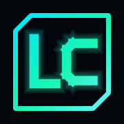

# Lucas Cassidori — Portfólio

**Engenheiro de Computação · Desenvolvedor Full Stack · IA**

Landing page pessoal com estética cyberpunk/neon, cena 3D em tempo real e animações guiadas pelo scroll.

### 🔗 [devcassidori.github.io/Site](https://devcassidori.github.io/Site/)

[](https://devcassidori.github.io/Site/)
[](https://www.linkedin.com/in/lucascassidori/)


</div>

---

## 📸 Preview

<p align="center">
  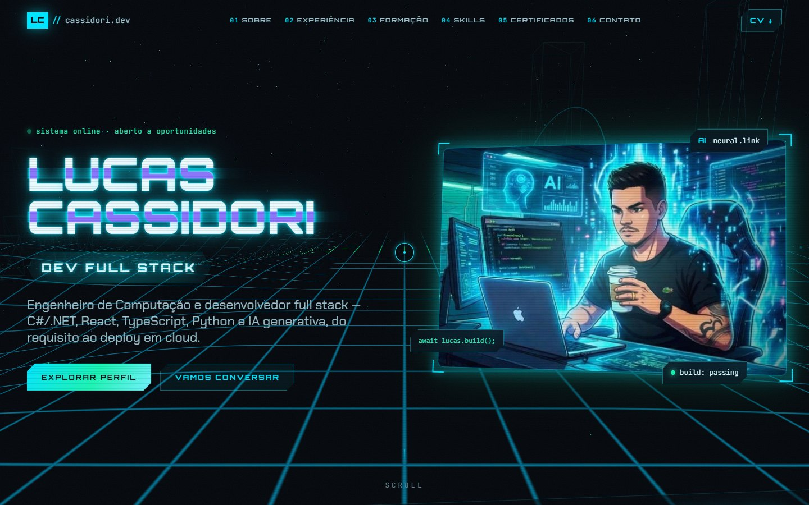
</p>

<table>
  <tr>
    <td width="50%">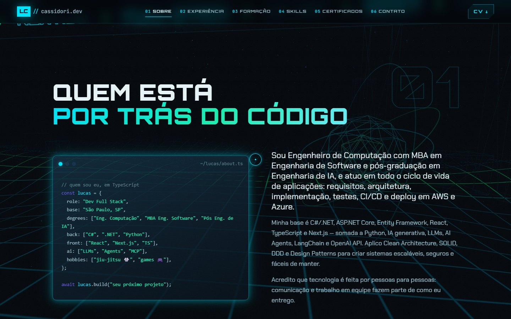<p align="center"><sub><b>Sobre</b> — terminal com typewriter</sub></p></td>
    <td width="50%">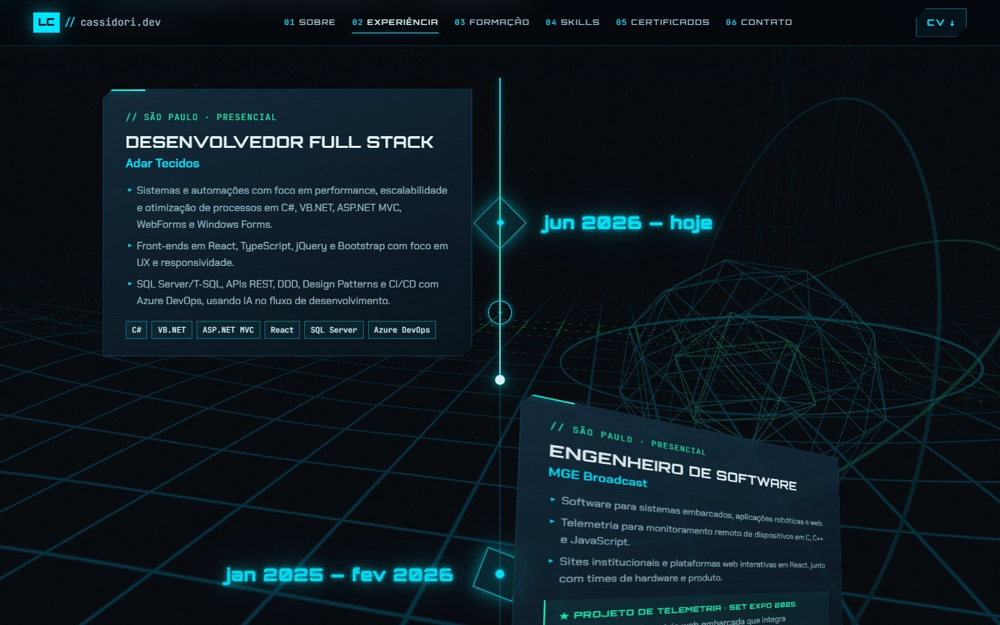<p align="center"><sub><b>Experiência</b> — timeline 3D guiada pelo scroll</sub></p></td>
  </tr>
  <tr>
    <td width="50%">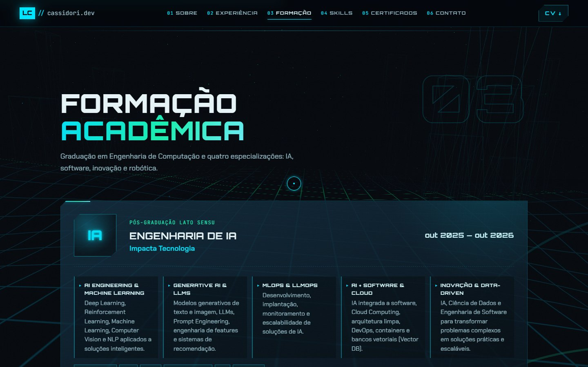<p align="center"><sub><b>Formação</b> — cards expansíveis</sub></p></td>
    <td width="50%">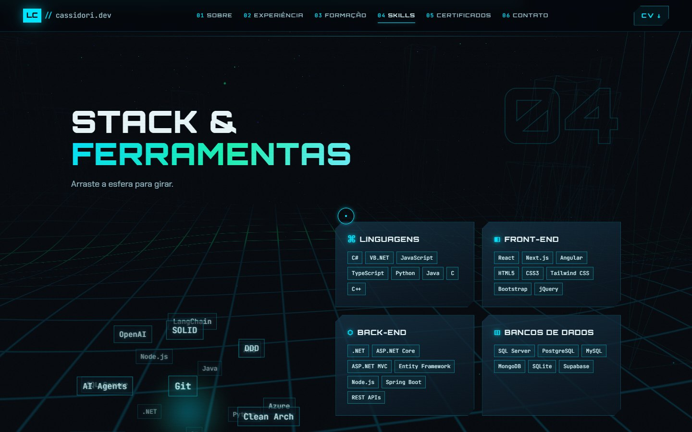<p align="center"><sub><b>Skills</b> — esfera 3D arrastável</sub></p></td>
  </tr>
  <tr>
    <td width="50%">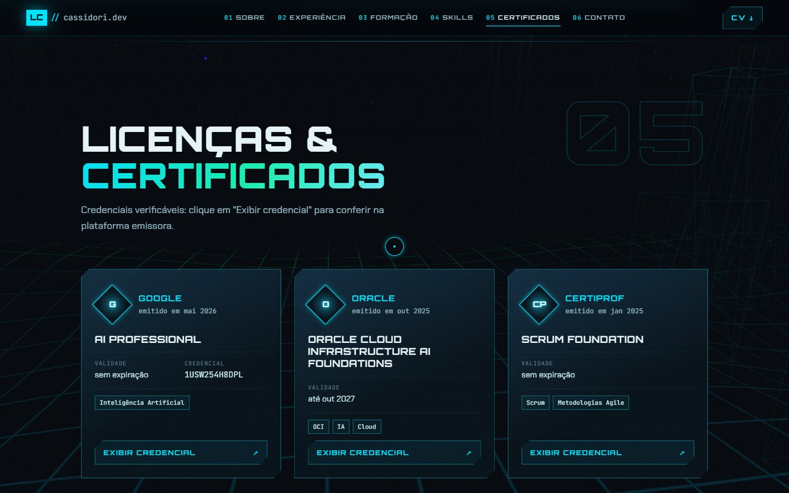<p align="center"><sub><b>Certificados</b> — crachás holográficos com credencial</sub></p></td>
    <td width="50%">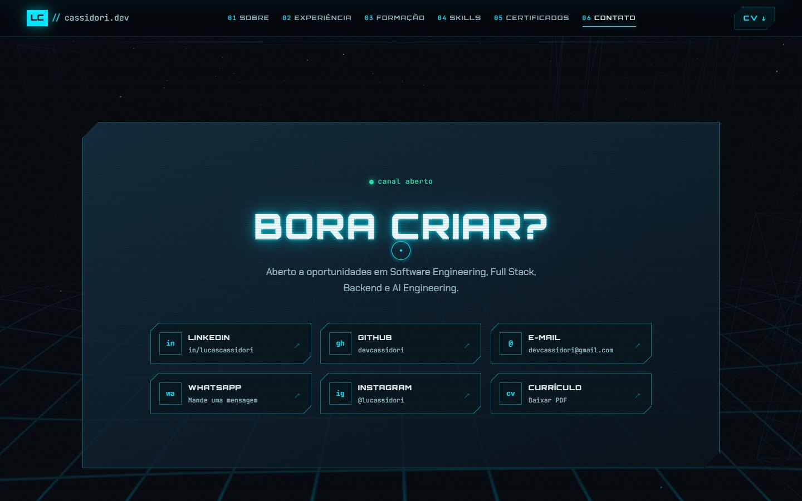<p align="center"><sub><b>Contato</b> — cards com hover neon</sub></p></td>
  </tr>
</table>

<p align="center"><b>Mobile</b></p>
<p align="center">
  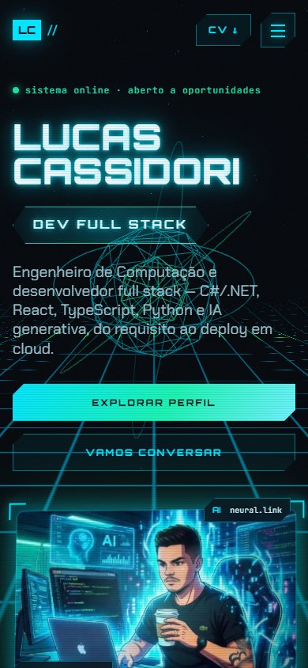
  &nbsp;
  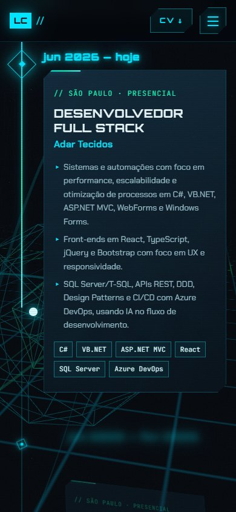
  &nbsp;
  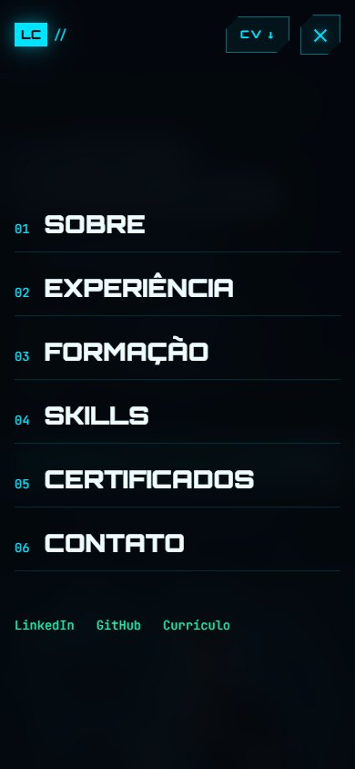
</p>

---

## ✨ Destaques

- **Cena 3D em tempo real** (Three.js): piso quadriculado neon com ondulação via shader, partículas de dados, núcleo holográfico com anéis e prédios em wireframe. A câmera segue o mouse e "mergulha" na cena conforme a rolagem.
- **Intro de boot** estilo terminal, seguida do nome entrando letra a letra com rotação 3D e efeito *glitch* periódico.
- **Hero** com a ilustração em um quadro holográfico que inclina com o mouse, chips flutuantes com parallax e cantos neon.
- **Timeline de experiência** com trilho que se preenche no scroll e cards que entram girando em 3D.
- **Formação** em cards expansíveis (abertos no desktop, recolhidos no celular).
- **Esfera 3D de skills** arrastável, animada só quando está visível.
- **Certificados** como crachás holográficos com validade, código e link para a credencial verificável.
- **Contato** com cards de hover neon: borda em gradiente, luz que segue o cursor, ícone preenchido e seta animada.
- **Navegação** com rolagem suave (Lenis), destaque da seção atual e menu hambúrguer em tela cheia no mobile.
- **100% responsivo**, testado em 320, 375, 768, 1024 e 1440px sem rolagem horizontal.
- **Acessibilidade**: respeita `prefers-reduced-motion`, foco visível, `aria-*` no menu e nos cards expansíveis.

## 🧭 Seções

| # | Seção | Conteúdo |
|---|---|---|
| — | **Hero** | Nome, cargo, resumo e chamadas para ação |
| 01 | **Sobre** | Apresentação, terminal "about.ts", hobbies e idiomas |
| 02 | **Experiência** | Adar Tecidos, MGE Broadcast (projeto de telemetria na SET Expo 2025), TCS, Uber e Santa Casa |
| 03 | **Formação** | Pós em Engenharia de IA e MBA em Engenharia de Software (Impacta), MBA em Inovação Digital e Pós em Engenharia Robótica (Anhanguera), Engenharia de Computação (São Judas) |
| 04 | **Skills** | Linguagens, front-end, back-end, bancos, cloud & DevOps, IA, arquitetura e ferramentas |
| 05 | **Certificados** | Google AI Professional, Oracle OCI AI Foundations, Certiprof (Scrum, Prompt Engineering, Lifelong Learning) |
| 06 | **Contato** | LinkedIn, GitHub, e-mail, WhatsApp, Instagram e currículo em PDF |

## 🎨 Design system "Neon-Grid"

Derivado da arte da capa: noite azul-petróleo, ciano elétrico e verde-água. Todos os tokens ficam em [`css/tokens.css`](css/tokens.css).

| Token | Valor | Uso |
|---|---|---|
| `--c-void` | `#03070c` | fundo mais profundo |
| `--c-abyss` | `#061019` | fundo da página |
| `--c-cyan` | `#00e5ff` | cor primária, holograma |
| `--c-aqua` | `#19f5b4` | cor secundária, destaques |
| `--c-violet` | `#7b5cff` | acento raro (glitch) |

- **Tipografia**: [Orbitron](https://fonts.google.com/specimen/Orbitron) (títulos), [Chakra Petch](https://fonts.google.com/specimen/Chakra+Petch) (texto) e [JetBrains Mono](https://fonts.google.com/specimen/JetBrains+Mono) (código e rótulos), em escala fluida com `clamp()`.
- **Forma**: cantos chanfrados (`--clip-chamfer`), bordas finas em ciano e brilho em camadas (`--glow-*`).
- **Movimento**: curvas `expo` (`--ease-out`) e durações em tokens, zeradas com `prefers-reduced-motion`.

## 🛠️ Tecnologias

| Biblioteca | Para quê |
|---|---|
| [Three.js](https://threejs.org/) `0.160` | Cena 3D de fundo (shaders próprios para o grid e as partículas) |
| [GSAP](https://gsap.com/) `3.12` + ScrollTrigger | Intro, entradas 3D, timeline e parallax |
| [Lenis](https://lenis.darkroom.engineering/) `1.1` | Rolagem suave |

Sem build e sem `npm install`: é HTML, CSS e JavaScript puros, com as bibliotecas carregadas por CDN.

## 📁 Estrutura

```
.
├── index.html             # marcação da landing page
├── css/
│   ├── tokens.css         # design system (cores, tipografia, espaçamento, movimento)
│   └── styles.css         # componentes e layout responsivo
├── js/
│   ├── scene.js           # cena 3D (Three.js)
│   └── main.js            # renderização do conteúdo, animações e interações
├── data/
│   └── profile.js         # TODO o conteúdo do site — edite aqui
├── assets/
│   ├── hero.webp          # ilustração da hero (632×411)
│   ├── favicon.svg        # favicon principal
│   ├── favicon-32.png     # favicon para navegadores sem suporte a SVG
│   └── apple-touch-icon.png
├── docs/screenshots/      # imagens deste README
└── server.js              # servidor local de desenvolvimento (Node, sem dependências)
```

## 🚀 Rodando localmente

Precisa só do [Node.js](https://nodejs.org/) (qualquer versão recente):

```bash
git clone https://github.com/devcassidori/Site.git
cd Site
node server.js
```

Abra **http://localhost:5173**.

> O fundo 3D usa ES modules, que os navegadores bloqueiam ao abrir o `index.html` direto do disco (`file://`). Por isso o servidor local é necessário — qualquer servidor estático funciona (ex.: `npx serve`, extensão Live Server do VS Code).

## ✏️ Editando o conteúdo

Todo o texto do site está em [`data/profile.js`](data/profile.js):

| Chave | Onde aparece |
|---|---|
| `headline`, `role`, `location` | Hero e terminal |
| `about`, `offCode`, `languages` | Sobre |
| `experience` | Timeline de experiência (`highlight` cria o destaque de projeto) |
| `education` | Cards de formação (`points` são os tópicos de cada curso) |
| `skillGroups`, `sphereSkills` | Grupos de skills e esfera 3D |
| `certificates` | Crachás (`url` é o link da credencial; `expires` e `code` são opcionais) |
| `links` | Contato, menu e botão de CV |

Para trocar a imagem da hero, substitua `assets/hero.webp` e ajuste `width`/`height` no `` do `index.html` e o `aspect-ratio` de `.holo-frame img` em `css/styles.css`.

## 🌐 Publicação (GitHub Pages)

O site é publicado direto da branch `main`:

1. **Settings → Pages**
2. **Source**: *Deploy from a branch*
3. **Branch**: `main` · pasta `/ (root)` → **Save**

Em 1–2 minutos ele fica disponível em **https://devcassidori.github.io/Site/**. A cada `git push` na `main`, o Pages publica a nova versão automaticamente.

## 📬 Contato

- LinkedIn: [in/lucascassidori](https://www.linkedin.com/in/lucascassidori/)
- GitHub: [@devcassidori](https://github.com/devcassidori)
- E-mail: [devcassidori@gmail.com](mailto:devcassidori@gmail.com)

---

<p align="center"><sub>Feito com café, código e neon ☕⚡</sub></p>
